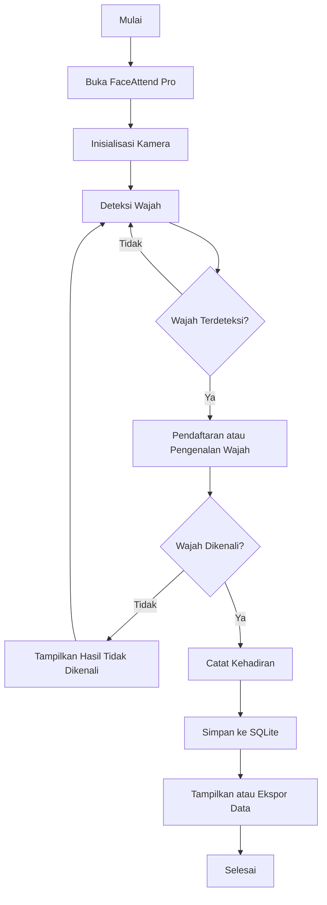

# FaceAttend Pro — Sistem Absensi Mahasiswa Berbasis Pengenalan Wajah

<p align="center">
  <strong>Aplikasi Absensi Otomatis Menggunakan Computer Vision</strong><br>
  Python · OpenCV · Tkinter · SQLite
</p>

---

## 📌 Deskripsi Proyek

**FaceAttend Pro** adalah aplikasi absensi otomatis yang memanfaatkan teknologi *face recognition* (pengenalan wajah) dan *computer vision* untuk membantu proses pencatatan kehadiran mahasiswa. Aplikasi ini dikembangkan menggunakan Python dengan antarmuka grafis berbasis Tkinter, deteksi wajah menggunakan OpenCV, serta penyimpanan data menggunakan SQLite.

Sistem dirancang untuk mengenali wajah yang telah didaftarkan sebelumnya, kemudian mencatat kehadiran berdasarkan hasil proses pengenalan tersebut. Data absensi dapat dikelola dan diekspor ke format CSV sehingga lebih mudah digunakan untuk rekapitulasi maupun pengolahan data lanjutan.

FaceAttend Pro dikembangkan sebagai proyek pembelajaran yang menggabungkan pemrograman Python, pengolahan citra digital, basis data, dan pengembangan aplikasi desktop.

## 🎯 Urgensi Proyek

Pencatatan kehadiran merupakan bagian penting dalam kegiatan akademik. Namun, proses absensi secara manual masih memiliki beberapa keterbatasan, seperti membutuhkan waktu, berpotensi menimbulkan kesalahan pencatatan, serta memerlukan proses rekapitulasi secara terpisah.

Di sisi lain, perkembangan teknologi *computer vision* memungkinkan komputer menganalisis citra dan mengenali karakteristik visual wajah. Teknologi tersebut dapat dimanfaatkan untuk mengembangkan sistem absensi yang lebih praktis dan terintegrasi.

FaceAttend Pro dikembangkan untuk mengeksplorasi pemanfaatan teknologi tersebut melalui aplikasi yang relatif sederhana dan dapat dijalankan pada komputer pribadi.

Urgensi pengembangan proyek ini meliputi:

- **Efisiensi waktu:** membantu mempercepat proses pencatatan kehadiran.
- **Otomatisasi pencatatan:** mengurangi ketergantungan pada proses absensi manual.
- **Integrasi teknologi:** menerapkan pengolahan citra digital dan pengenalan pola dalam kasus nyata.
- **Kemudahan pengelolaan data:** menyimpan data mahasiswa dan absensi dalam basis data.
- **Media pembelajaran:** menjadi contoh penerapan Python, OpenCV, SQLite, dan antarmuka grafis dalam satu aplikasi.

> **Catatan:** FaceAttend Pro merupakan proyek pembelajaran dan prototipe. Kemampuan serta tingkat akurasinya perlu diuji lebih lanjut sebelum digunakan untuk absensi resmi.

## ✨ Fitur Utama

- **Deteksi wajah:** mendeteksi wajah melalui kamera menggunakan OpenCV dan Haar Cascade.
- **Pendaftaran wajah:** mengambil sampel wajah untuk proses pengenalan.
- **Pengenalan wajah:** mencocokkan karakteristik wajah menggunakan pendekatan histogram *Local Binary Patterns* (LBP).
- **Pencatatan absensi:** menyimpan catatan kehadiran ke basis data SQLite.
- **Manajemen data:** mengelola data mahasiswa dan catatan absensi sesuai fitur yang tersedia pada aplikasi.
- **Ekspor data:** mengekspor catatan absensi ke format CSV.
- **Antarmuka grafis:** menyediakan tampilan desktop berbasis Tkinter.
- **Penyimpanan lokal:** menyimpan data aplikasi secara lokal pada komputer pengguna.

## 🛠️ Teknologi yang Digunakan

| Teknologi | Kegunaan |
|---|---|
| Python | Bahasa pemrograman utama |
| OpenCV | Pemrosesan citra dan deteksi wajah |
| Haar Cascade | Deteksi area wajah |
| NumPy | Operasi numerik dan pengolahan data citra |
| LBP Histogram | Representasi tekstur wajah untuk pencocokan |
| Tkinter | Antarmuka grafis aplikasi |
| SQLite | Penyimpanan data mahasiswa dan absensi |
| CSV | Ekspor data kehadiran |
| Pillow | Pengolahan dan penampilan gambar pada antarmuka |

### Library yang Digunakan

Proyek ini menggunakan library berikut:

- `numpy`
- `opencv-python`
- `Pillow`

Tkinter dan SQLite umumnya sudah tersedia melalui instalasi Python standar. Pada distribusi Python tertentu, Tkinter mungkin perlu dipasang secara terpisah.

**Proyek ini tidak menggunakan TensorFlow, MediaPipe, Pygame, PyTorch (`torch`), maupun `playsound`.**

## 📂 Struktur Direktori

```text
FaceAttendPro/
├── app.py
├── requirements.txt
├── README.md
├── run_windows.bat
├── run_python.bat
├── data/
├── faces/
├── models/
└── exports/
```

Keterangan:

| File/Folder | Fungsi |
|---|---|
| `app.py` | Program utama aplikasi |
| `requirements.txt` | Daftar dependensi Python |
| `README.md` | Dokumentasi proyek |
| `run_windows.bat` | Skrip untuk memasang dependensi dan menjalankan aplikasi menggunakan Python 3.15 |
| `run_python.bat` | Skrip alternatif untuk menjalankan aplikasi dengan perintah `python` |
| `data/` | Penyimpanan data aplikasi |
| `faces/` | Penyimpanan sampel wajah |
| `models/` | Direktori untuk berkas pendukung model atau konfigurasi pengenalan |
| `exports/` | Direktori untuk hasil ekspor |

Isi direktori dapat bertambah sesuai data yang dibuat selama aplikasi digunakan.

## ⚙️ Persyaratan Sistem

Sebelum menjalankan aplikasi, pastikan komputer memenuhi persyaratan berikut:

- Sistem operasi Windows atau lingkungan desktop yang mendukung Tkinter.
- Python yang kompatibel dengan versi OpenCV dan NumPy yang digunakan.
- Kamera internal atau kamera USB.
- Koneksi internet saat memasang dependensi melalui `pip`.
- Hak akses untuk menjalankan aplikasi dan menyimpan data di direktori proyek.

### Catatan Kompatibilitas Python

Skrip `run_windows.bat` dikonfigurasi untuk menggunakan Python 3.15. Namun, kompatibilitas Python 3.15 bergantung pada versi OpenCV, NumPy, dan paket yang tersedia untuk instalasi tersebut.

Jika terjadi masalah instalasi atau OpenCV tidak menyediakan API yang diperlukan, gunakan versi Python yang didukung oleh paket-paket tersebut, misalnya Python 3.12 atau 3.13, sesuai hasil pengujian lingkungan.

## 🚀 Instalasi dan Menjalankan Aplikasi

### 1. Unduh atau Kloning Proyek

Jika proyek berada di repositori GitHub, kloning menggunakan perintah berikut:

```bash
git clone https://github.com/USERNAME/FaceAttendPro.git
```

Ganti `USERNAME/FaceAttendPro` dengan alamat repositori yang sebenarnya.

Masuk ke direktori proyek:

```bash
cd FaceAttendPro
```

Jika folder proyek sudah tersedia di komputer, langsung buka folder tersebut melalui terminal atau VS Code.

### 2. Buat Virtual Environment

Buat lingkungan virtual agar dependensi proyek terpisah dari instalasi Python lainnya.

```bash
python -m venv .venv
```

Aktifkan virtual environment di Windows Command Prompt:

```bat
.venv\Scripts\activate
```

Jika menggunakan PowerShell:

```powershell
.\.venv\Scripts\Activate.ps1
```

### 3. Pasang Dependensi

Jalankan perintah berikut:

```bash
python -m pip install --upgrade pip
python -m pip install -r requirements.txt
```

Pastikan proses instalasi selesai tanpa kesalahan.

### 4. Jalankan Aplikasi

Setelah dependensi terpasang, jalankan:

```bash
python app.py
```

Alternatifnya, jalankan file `run_python.bat` melalui Windows.

Jika ingin menggunakan `run_windows.bat`, pastikan Python 3.15 tersedia melalui Python Launcher dan sesuai dengan dependensi proyek.

## 🧭 Alur Kerja Sistem

Secara umum, alur kerja FaceAttend Pro dapat digambarkan sebagai berikut:



Diagram tersebut merupakan gambaran umum proses sistem. Alur aktual dapat menyesuaikan dengan pilihan menu dan implementasi pada `app.py`.

## 🧠 Metode Pengenalan Wajah

FaceAttend Pro menggunakan pendekatan pengolahan citra klasik untuk mendukung deteksi dan pencocokan wajah.

### 1. Deteksi Wajah Menggunakan Haar Cascade

Haar Cascade digunakan untuk menemukan area wajah pada gambar yang diperoleh dari kamera. Proses ini membantu menentukan bagian citra yang akan diproses lebih lanjut.

### 2. Ekstraksi Karakteristik Menggunakan LBP

*Local Binary Patterns* (LBP) merupakan metode untuk menggambarkan pola tekstur lokal pada citra. Hasil ekstraksi dapat dirangkum dalam histogram yang digunakan sebagai representasi karakteristik wajah.

### 3. Pencocokan Wajah

Representasi wajah yang diperoleh dibandingkan dengan data sampel yang telah tersimpan. Hasil pencocokan kemudian digunakan untuk menentukan apakah wajah dapat dikenali berdasarkan ambang batas yang ditentukan.

Metode ini relatif ringan dan cocok untuk eksperimen pembelajaran. Namun, hasilnya dapat dipengaruhi oleh pencahayaan, sudut wajah, jarak kamera, ekspresi, dan kualitas sampel.

**Penting:** Haar Cascade bertugas mendeteksi area wajah, sedangkan proses pencocokan identitas dilakukan melalui metode pengenalan yang diterapkan pada aplikasi. Deteksi wajah saja tidak membuktikan identitas seseorang.

## 🔧 Konfigurasi

Beberapa parameter yang terdapat dalam implementasi dapat memengaruhi proses pengenalan wajah.

| Parameter | Fungsi |
|---|---|
| `SAMPLES_TO_CAPTURE` | Menentukan jumlah sampel yang dikumpulkan saat pendaftaran wajah |
| `RECOGNITION_THRESHOLD` | Menentukan ambang batas pencocokan wajah |
| `IMG_SIZE` | Menentukan ukuran citra yang digunakan dalam pemrosesan |

Nilai parameter sebaiknya diperiksa langsung pada `app.py`, karena konfigurasi aktual dapat berubah mengikuti pengembangan proyek.

Pengaturan ambang batas harus diuji menggunakan sampel yang berbeda. Ambang batas yang terlalu longgar dapat meningkatkan risiko salah mengenali wajah, sedangkan ambang batas yang terlalu ketat dapat menyebabkan wajah yang benar tidak dikenali.

## 🐛 Pemecahan Masalah

### 1. `AttributeError: module 'cv2' has no attribute 'CascadeClassifier'`

Kesalahan ini dapat terjadi jika instalasi OpenCV bermasalah, modul `cv2` tertimpa oleh berkas lain, atau paket yang terpasang tidak menyediakan API yang diharapkan.

Coba langkah berikut pada virtual environment proyek:

```bash
python -m pip uninstall -y opencv-python opencv-contrib-python opencv-python-headless opencv-contrib-python-headless
python -m pip install opencv-python==4.11.0.86
```

Setelah itu, uji ketersediaan API:

```bash
python -c "import cv2; print(cv2.__version__); print(hasattr(cv2, 'CascadeClassifier'))"
```

Jika berhasil, keluaran terakhir seharusnya menunjukkan:

```text
True
```

Pastikan tidak ada file lokal bernama `cv2.py` atau folder `cv2` yang menghalangi impor OpenCV. Jika masalah tetap terjadi, periksa kompatibilitas versi Python dan OpenCV.

### 2. Kamera Tidak Terbuka

- Pastikan kamera terhubung dan dapat digunakan.
- Tutup aplikasi lain yang sedang menggunakan kamera.
- Periksa izin akses kamera pada sistem operasi.
- Pastikan indeks kamera yang digunakan sesuai dengan perangkat.

### 3. Wajah Sulit Dikenali

- Gunakan pencahayaan yang cukup dan merata.
- Arahkan wajah ke kamera.
- Hindari wajah tertutup atau terlalu jauh dari kamera.
- Ambil sampel pendaftaran yang bervariasi tetapi tetap jelas.
- Uji kembali nilai `RECOGNITION_THRESHOLD`.

### 4. Dependensi Gagal Dipasang

Periksa versi Python dan pip:

```bash
python --version
python -m pip --version
```

Pastikan terminal menggunakan virtual environment yang benar. Jika versi Python terlalu baru untuk salah satu paket, gunakan versi Python yang kompatibel dengan seluruh dependensi proyek.

## 🧪 Pengujian yang Disarankan

Sebelum aplikasi digunakan dalam kegiatan nyata, lakukan pengujian berikut:

1. **Pengujian deteksi:** pastikan wajah terdeteksi pada berbagai kondisi pencahayaan.
2. **Pengujian pendaftaran:** pastikan sampel wajah berhasil direkam dan tersimpan.
3. **Pengujian pengenalan:** uji wajah terdaftar dan wajah yang belum terdaftar.
4. **Pengujian pencatatan:** pastikan kehadiran disimpan ke basis data dengan informasi yang sesuai.
5. **Pengujian ekspor:** pastikan data CSV dapat dibuat dan dibuka.
6. **Pengujian kamera:** periksa perilaku aplikasi ketika kamera tidak tersedia.
7. **Pengujian konsistensi:** periksa apakah pencatatan berulang menghasilkan data sesuai aturan aplikasi.

Jika ingin mengevaluasi kualitas pengenalan, gunakan data pengujian terpisah dan ukur tingkat keberhasilan, salah terima (*false acceptance*), serta salah tolak (*false rejection*).

## 🔐 Privasi dan Keamanan Data

Karena aplikasi memproses citra wajah, pengelolaan data perlu dilakukan dengan hati-hati.

- Dapatkan persetujuan sebelum mengumpulkan dan menggunakan sampel wajah.
- Simpan data hanya untuk tujuan yang telah disampaikan kepada pengguna.
- Batasi akses ke direktori `faces/`, `data/`, dan hasil ekspor.
- Jangan mengunggah sampel wajah atau basis data pribadi ke repositori publik.
- Hapus data yang tidak lagi diperlukan sesuai kebijakan penyimpanan.
- Lakukan pencadangan basis data secara aman jika diperlukan.

Aplikasi ini menggunakan pendekatan pengenalan wajah klasik dan **belum dapat dianggap sebagai sistem autentikasi biometrik dengan keamanan tinggi**. Tanpa mekanisme *liveness detection* atau anti-spoofing, sistem juga belum dapat memastikan bahwa input berasal dari orang sungguhan dan bukan foto atau tampilan wajah pada layar.

## ⚠️ Batasan Proyek

Beberapa batasan yang perlu diperhatikan:

- Akurasi pengenalan bergantung pada kualitas sampel dan kondisi lingkungan.
- LBP merupakan metode berbasis tekstur yang dapat kurang andal pada perubahan pencahayaan atau pose yang besar.
- Deteksi menggunakan Haar Cascade tidak selalu berhasil pada semua sudut wajah.
- Sistem belum memiliki jaminan anti-spoofing.
- Pengujian yang memadai diperlukan sebelum penerapan dalam skala besar.
- Prototipe ini tidak boleh dijadikan satu-satunya dasar untuk keputusan akademik penting tanpa validasi dan prosedur koreksi.

## 🔮 Pengembangan Selanjutnya

Pengembangan FaceAttend Pro dapat diarahkan pada beberapa hal berikut:

- Menambahkan laporan statistik kehadiran.
- Memperbaiki validasi input dan penanganan kesalahan.
- Menyediakan fitur pencadangan dan pemulihan basis data.
- Mengembangkan pengujian akurasi dengan dataset yang terkontrol.
- Meningkatkan keamanan penyimpanan data biometrik.
- Menambahkan mekanisme anti-spoofing.
- Memperbaiki pengalaman pengguna dan aksesibilitas antarmuka.
- Menyediakan autentikasi pengguna dan pembatasan hak akses.

Fitur tambahan perlu disesuaikan dengan tujuan proyek dan hasil pengujian, bukan dianggap sudah tersedia pada implementasi saat ini.

## 👨‍💻 Tujuan Pembelajaran

Melalui proyek ini, pengembang dapat mempelajari:

- Penerapan Python dalam pengembangan aplikasi desktop.
- Pemrosesan citra digital menggunakan OpenCV.
- Deteksi dan pencocokan pola wajah.
- Integrasi basis data SQLite.
- Pembuatan antarmuka grafis menggunakan Tkinter.
- Ekspor dan pengelolaan data menggunakan CSV.
- Pengujian aplikasi serta identifikasi keterbatasan metode pengenalan wajah.

## 📄 Lisensi

Lisensi proyek belum ditentukan. Sebelum memublikasikan proyek ke GitHub, tentukan lisensi yang sesuai dengan tujuan penggunaan dan distribusi kode. Jika ingin mengizinkan penggunaan ulang secara terbuka, pertimbangkan lisensi perangkat lunak sumber terbuka yang sesuai.

---

<p align="center">
  <strong>FaceAttend Pro</strong><br>
  Sistem Absensi Mahasiswa Berbasis Pengenalan Wajah
</p>
